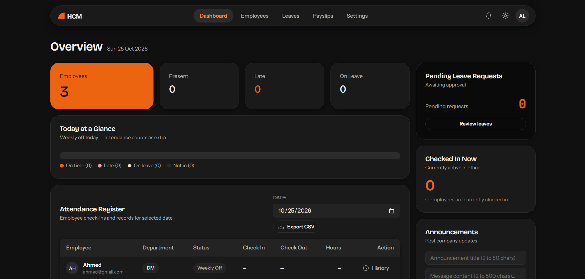
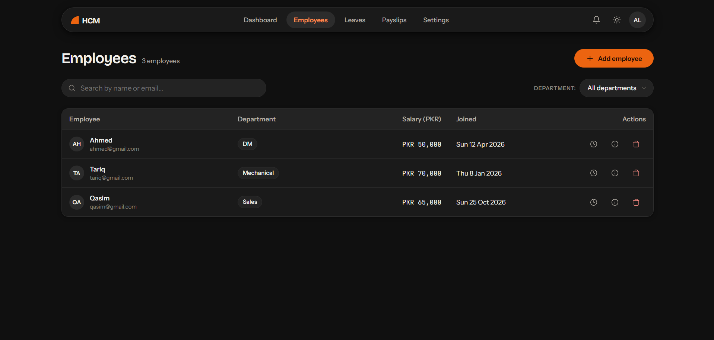
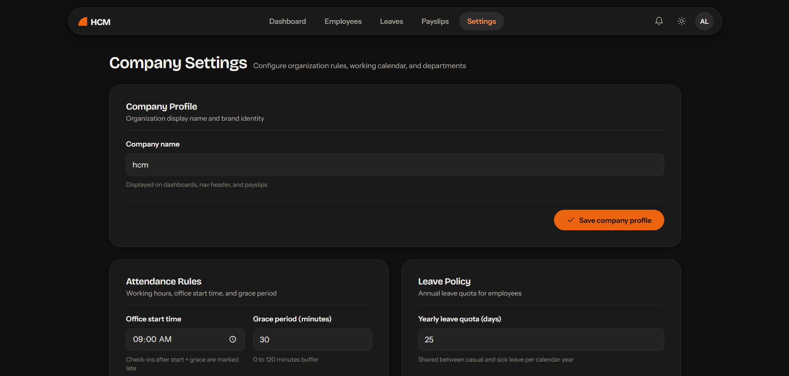
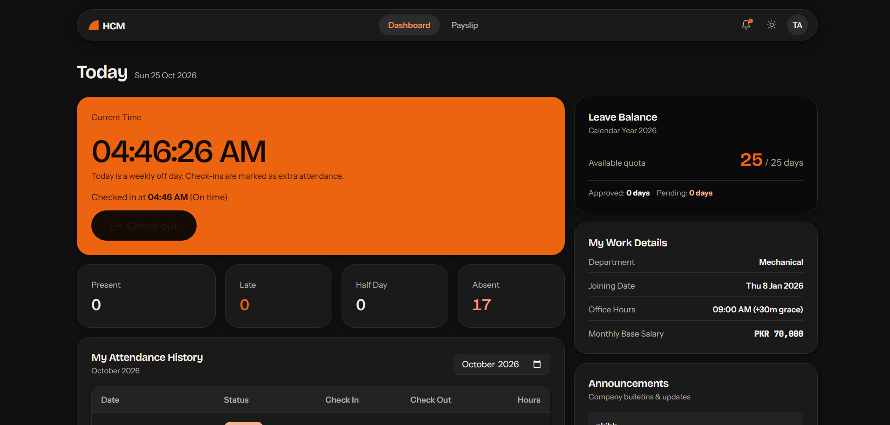

HCM Lite — Human Capital Management System
HCM Lite is a browser-based HR management application built with HTML, CSS, and vanilla JavaScript for the Saylani Hackathon Beginner Track.

It provides a simple interface for administrators to manage employees, monitor attendance, process leave requests, and generate payslips. Employees can check in and out, apply for leave, review their attendance, and view their payslips.

## Screenshots

### Admin Dashboard

### Employee Management

### Company Settings

### Employee Portal

Features
Admin Portal

- Company setup and administrator account creation
- Employee creation, editing, searching, filtering, and deletion
- Department management
- Attendance records and daily attendance overview
- Leave request approval and rejection with comments
- Configurable office hours, grace periods, working days, and leave quotas
- Dashboard summaries, charts, and attendance visualizations
- Company announcements
- Monthly payslip generation and printing
- Attendance CSV export
- Smart Helper for answering questions about stored HR data
  Employee Portal
- Secure-form login and session handling
- Daily check-in and check-out
- Personal attendance history and working-hour summaries
- Leave applications, status tracking, and leave balances
- Company announcements
- Personal payslip viewing and printing
- Smart Helper for questions about personal attendance and leave
  Interface
- Light and dark themes
- Responsive desktop and mobile layouts
- Reusable navigation and interface components
- Printable payslips
- Form validation and user feedback
  Technology Stack
- HTML5 — page structure
- CSS3 — styling, responsive layouts, and themes
- Vanilla JavaScript — application logic and interactions
- Browser localStorage — local data persistence
- Chart.js — dashboard charts
- Google Fonts — typography
  No frontend framework, backend server, database server, or build process is required.
  Run Locally

1. Download or clone this repository.
2. Open the project folder in a terminal.
3. Start a local web server:
   python -m http.server 8000
   On Windows, you can also use:
   py -m http.server 8000
4. Open http://localhost:8000 in your browser.
5. On the first visit, create your company and administrator account.
6. Use the administrator portal to configure settings and create employee accounts.
   Python is only needed to serve the files locally; it is not part of the application's runtime.

Google Fonts and Chart.js are loaded from external services, so those resources may be unavailable without an internet connection.
First-Time Usage

1. Set up the company and administrator account.
2. Review the office hours, grace period, working days, and annual leave quota.
3. Add departments and employee accounts.
4. Sign in as an employee to record attendance or apply for leave.
5. Sign in as the administrator to review attendance and approve or reject leave requests.
6. Open Payslips to review salary calculations and print the required reports.
   The application does not include preconfigured demo credentials. Create an administrator account during the initial setup.
   Default Business Rules
   The application starts with these default settings, which can be changed by the administrator:

- Office start time: 9:00 AM
- Grace period: 15 minutes
- Annual leave quota: 12 days
- Working days: Monday through Saturday
- Half-day classification: less than five hours worked
- Late arrival: check-in after the office start time plus the grace period
  Salary deductions and leave balances are calculated from the attendance, leave, and company settings stored in the application.
  Project Structure
  .
  ├── index.html
  ├── pages/
  │ ├── admin.html
  │ ├── employees.html
  │ ├── leaves.html
  │ ├── settings.html
  │ ├── employee.html
  │ └── payslip.html
  ├── css/
  │ ├── style.css
  │ └── print.css
  ├── js/
  │ ├── pages/
  │ ├── storage.js
  │ ├── auth.js
  │ ├── attendance.js
  │ ├── leave.js
  │ ├── employees.js
  │ ├── payslip.js
  │ ├── helper.js
  │ ├── charts.js
  │ ├── ui.js
  │ └── theme-boot.js
  └── docs/
  ├── ARCHITECTURE.md
  ├── BUSINESS_RULES.md
  └── DESIGN.md
  Deployment
  This is a static website and can be hosted using GitHub Pages.

1. Upload the project files to a GitHub repository.
2. Open the repository's Settings → Pages.
3. Under the build and deployment settings, choose Deploy from a branch.
4. Select the main branch and the repository root (/), then save.
5. After GitHub Pages publishes the site, copy its URL into this README.
   Data Storage and Security
   HCM Lite stores its records in the browser's localStorage. Data is associated with the browser profile and website origin, rather than a shared server database.

Consequently:

- Data does not automatically sync across devices or browsers.
- Opening the local version and the GitHub Pages version creates separate storage contexts.
- Clearing the browser's site data can remove stored application records.
- Client-side authentication and password hashing do not provide production-grade security.
  This project is a hackathon prototype and learning project, not a production HR or payroll system. Do not use it to store real confidential employee, salary, or personal information.
  Known Limitations
- No server-side database or shared account system
- No centralized synchronization or backup system
- No production-grade server-side authorization
- No holiday calendar
- Salary calculations are simplified and do not prorate salaries for employees who join mid-month
  Documentation
  The docs/ directory contains the project's architecture, business rules, and design specifications.
  License
  No license has been specified yet. Add a license only after deciding how you want others to use, modify, and redistribute the project.
